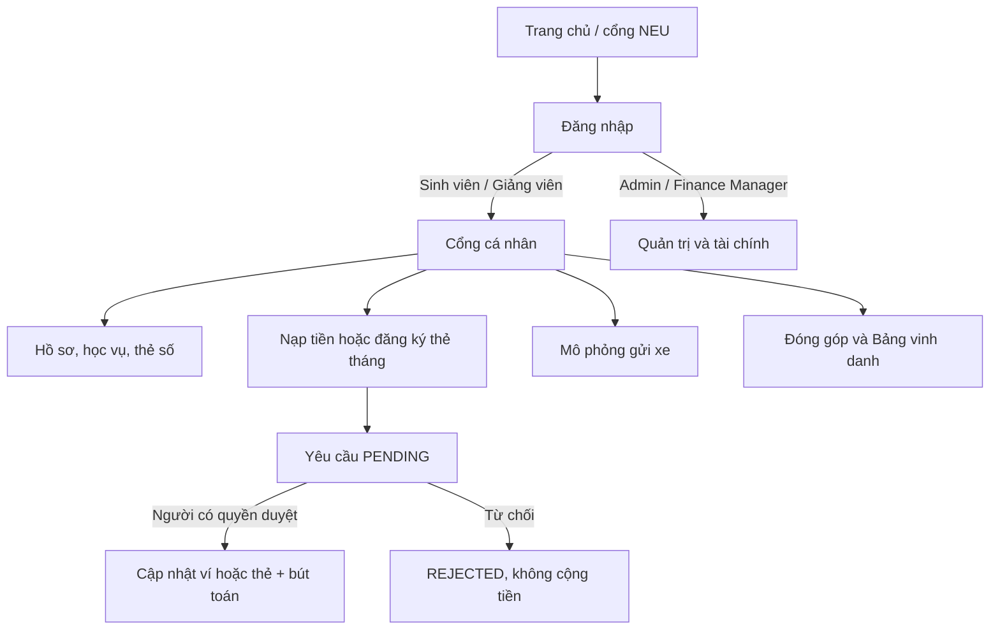

# NEU Smart Campus One-Card

Ứng dụng web demo Flask mô phỏng thẻ One-Card cho sinh viên và giảng viên NEU. Dự án kết hợp định danh/phân quyền, hồ sơ học vụ, ví mô phỏng, gửi xe, đóng góp trực tuyến và trợ lý hướng dẫn theo từng trang. Database chạy riêng trên từng máy; dataset khởi tạo được quản lý riêng tại [`data/demo_dataset.json`](./data/demo_dataset.json).

> Đây là đồ án/demo học tập. Chuyển khoản, số dư, phê duyệt và phí gửi xe chỉ được mô phỏng; không dùng cho thanh toán hoặc lưu hồ sơ chính thức.

## Mục lục

- [Chức năng và luồng sử dụng](#chức-năng-và-luồng-sử-dụng)
- [Công nghệ và thư viện](#công-nghệ-và-thư-viện)
- [Cài đặt lần đầu](#cài-đặt-lần-đầu)
- [Chạy ứng dụng](#chạy-ứng-dụng)
- [Tài khoản và dữ liệu demo](#tài-khoản-và-dữ-liệu-demo)
- [Cấu trúc dự án](#cấu-trúc-dự-án)
- [Nhánh và quy trình đóng góp](#nhánh-và-quy-trình-đóng-góp)
- [Trợ lý Gemini tùy chọn](#trợ-lý-gemini-tùy-chọn)
- [Ghi chú dữ liệu và bảo mật](#ghi-chú-dữ-liệu-và-bảo-mật)

## Chức năng và luồng sử dụng



### Cổng cá nhân

- `/` giới thiệu cổng NEU; `/login` xử lý đăng nhập và điều hướng theo vai trò.
- Sinh viên xem thẻ số, số dư, hồ sơ, học vụ và trạng thái học phí. Giảng viên xem hồ sơ, giờ giảng và thu nhập demo.
- Nạp tiền yêu cầu số tiền hợp lệ, họ tên khớp hồ sơ, mã tham chiếu và xác nhận đã chuyển. Yêu cầu vào hàng chờ; ví chỉ được cộng sau khi người có quyền duyệt.
- Đăng ký thẻ tháng yêu cầu chọn loại xe, biển số xe máy, mã tham chiếu và xác nhận. Phí demo: xe đạp 45.000đ/tháng, xe máy 70.000đ/tháng. Khi duyệt, thẻ được kích hoạt 30 ngày.
- Gửi xe mô phỏng tính phí theo phương tiện và khung giờ. Thẻ tháng còn hạn được miễn phí; lượt gửi được ghi lịch sử và trừ ví theo biểu phí.
- Đóng góp mô phỏng hỗ trợ quỹ học bổng hoặc gửi xe. Người dùng chọn phạm vi hiển thị; khoản đóng góp chỉ lên Bảng vinh danh sau khi được duyệt.

### Quản trị và tài chính

- Admin xem và duyệt/từ chối nạp tiền, đăng ký thẻ tháng và khoản đóng góp. Duyệt giao dịch tài chính cập nhật số dư/thẻ và ghi bút toán.
- Admin quản lý hồ sơ sinh viên/giảng viên, cập nhật số dư demo, cấp hoặc thu hồi quyền `FINANCE_MANAGER`.
- Người có quyền `FINANCE_MANAGER` được vào khu vực tài chính để xử lý hàng đợi theo phân quyền.

### Các trang chính

| URL | Vai trò | Nội dung |
|---|---|---|
| `/` | Mọi người | Cổng giới thiệu/xác minh NEU |
| `/login` | Mọi người | Đăng nhập và điều hướng theo vai trò |
| `/portal/dashboard` | Sinh viên, giảng viên | Thẻ số, hồ sơ, học vụ hoặc bảng kê giảng dạy |
| `/portal/payments` | Sinh viên, giảng viên | Nạp tiền, đăng ký thẻ tháng, lịch sử giao dịch |
| `/portal/parking` | Sinh viên, giảng viên | Mô phỏng gửi xe, biểu phí, lịch sử ra/vào |
| `/portal/giving` | Sinh viên, giảng viên | Đóng góp và Bảng vinh danh |
| `/admin/dashboard` | Admin, Finance Manager | Hàng chờ giao dịch và khoản đóng góp cần duyệt |
| `/admin/accounts` | Admin | CRUD tài khoản và phân quyền tài chính |
| `/admin/finance` | Admin, Finance Manager | Khu vực quản lý dòng tiền |

## Công nghệ và thư viện

### Backend

| Công nghệ | Vai trò | Nguồn |
|---|---|---|
| Python 3.9+ | Ngôn ngữ ứng dụng; dùng thư viện chuẩn `sqlite3`, `json`, `urllib`, `datetime` | [Python](https://www.python.org/downloads/) |
| Flask 3.0.3 | Routes, session và tích hợp template | [Flask](https://flask.palletsprojects.com/en/stable/) |
| Werkzeug 3.0.3 | WSGI và tiện ích HTTP đi cùng Flask | [Werkzeug](https://werkzeug.palletsprojects.com/en/stable/) |
| Jinja2 3.1.4 | Kết xuất template HTML | [Jinja](https://jinja.palletsprojects.com/en/stable/) |
| SQLite | Database dạng file; truy cập bằng `sqlite3` có sẵn trong Python, không cần cài server | [SQLite](https://www.sqlite.org/index.html) |

Phiên bản các gói Python được khóa trong [`requirements.txt`](./requirements.txt). `pip install -r requirements.txt` sẽ cài cả các dependency phụ thuộc.

### Giao diện và dịch vụ ngoài

| Thành phần | Cách dùng | Nguồn |
|---|---|---|
| HTML5 + Vanilla JavaScript | Template, biểu mẫu, chat và tương tác trình duyệt | [MDN Web Docs](https://developer.mozilla.org/) |
| Tailwind CSS Play CDN | Utility classes, không cần Node/npm để chạy demo | [Tài liệu Play CDN](https://tailwindcss.com/docs/installation/play-cdn) |
| Inter | Font giao diện từ Google Fonts | [Google Fonts – Inter](https://fonts.google.com/specimen/Inter) |
| VietQR image | Sinh ảnh QR chuyển khoản demo từ URL | [VietQR](https://www.vietqr.io/) |
| Gemini API (tùy chọn) | Trợ lý theo nội dung trang; gọi REST từ backend với model `gemini-3.5-flash-lite` | [Model](https://ai.google.dev/gemini-api/docs/models/gemini-3.5-flash-lite), [Interactions API](https://ai.google.dev/gemini-api/docs/interactions-overview) |

Tailwind Play CDN, Google Fonts và VietQR cần trình duyệt có Internet. Play CDN phù hợp demo/phát triển; production cần thiết lập quy trình build CSS riêng theo [hướng dẫn Tailwind](https://tailwindcss.com/docs/installation).

## Cài đặt lần đầu

### Windows PowerShell

1. Cài [Python 3.9 trở lên](https://www.python.org/downloads/) và [Git](https://git-scm.com/downloads/). Có thể bật tùy chọn thêm Python vào `PATH` hoặc dùng lệnh `py`.
2. Clone và vào thư mục dự án:

   ```powershell
   git clone https://github.com/quanxyz2006-del/neu-smart-campus-onecard.git
   cd neu-smart-campus-onecard
   ```

3. Tạo môi trường ảo, cài thư viện:

   ```powershell
   py -m venv .venv
   .\.venv\Scripts\Activate.ps1
   python -m pip install --upgrade pip
   pip install -r requirements.txt
   ```

   Nếu PowerShell chặn script kích hoạt, gọi interpreter trực tiếp:

   ```powershell
   .\.venv\Scripts\python.exe -m pip install -r requirements.txt
   ```

### macOS / Linux

```bash
git clone https://github.com/quanxyz2006-del/neu-smart-campus-onecard.git
cd neu-smart-campus-onecard
python3 -m venv .venv
source .venv/bin/activate
python -m pip install --upgrade pip
pip install -r requirements.txt
```

## Chạy ứng dụng

Từ thư mục dự án, sau khi kích hoạt `.venv`:

```bash
python app.py
```

Windows có thể dùng `py app.py` hoặc `\.venv\Scripts\python.exe app.py`. Mở **http://127.0.0.1:5000**. Dừng server bằng `Ctrl+C` trong terminal.

Lần chạy đầu, ứng dụng tự tạo `neu_smart_campus.db`, schema và dữ liệu mẫu nếu database chưa có tài khoản. Có thể nạp thủ công bằng `python seed.py`; thao tác dùng `INSERT OR IGNORE` để tránh tạo trùng các bản ghi mẫu. Database runtime nằm cạnh `database.py` và không được commit.

## Tài khoản và dữ liệu demo

| Vai trò | Tên đăng nhập | Mật khẩu khởi tạo | Ghi chú |
|---|---|---|---|
| Super Admin | `quan2006` | `123456` | Toàn quyền quản trị |
| Sinh viên mẫu | `11244018` | `hoangminhquan` | Số dư demo ban đầu 50.000đ |
| Giảng viên tài chính | `GV004` | `nguyenvanminh` | Có quyền `FINANCE_MANAGER`, số dư 50.000đ |
| Sinh viên khác | Mã số trong dataset | Họ tên bỏ dấu, viết liền, chữ thường | `Pham Tuan Anh` → `phamtuananh` |
| Giảng viên khác | `GV001`–`GV006` | Họ tên bỏ dấu, viết liền, chữ thường | Số dư demo 50.000đ |

Dataset riêng tại [`data/demo_dataset.json`](./data/demo_dataset.json) gồm 43 sinh viên và 6 giảng viên mẫu. `seed.py` đọc JSON này và tạo tài khoản, thẻ, hồ sơ học vụ/giờ giảng. Biểu phí được tạo bởi `database.py`. Thành viên không cần sao chép file `.db`; mỗi người tạo database của mình từ dataset đã commit.

Thông tin đăng nhập trên là tài khoản demo được công khai cùng mã nguồn; không tái sử dụng mật khẩu này ở dịch vụ thật. Mật khẩu các tài khoản mẫu được sinh từ tên trong dataset, không lưu thành trường riêng trong JSON.

Để khởi tạo lại database demo cục bộ, dừng ứng dụng rồi xóa riêng file DB và chạy lại (mọi thay đổi demo trên máy đó sẽ mất):

```powershell
Remove-Item .\neu_smart_campus.db
python app.py
```

macOS/Linux: `rm neu_smart_campus.db && python app.py`.

## Cấu trúc dự án

```text
.
├── AGENTS.md                    # Đặc tả nghiệp vụ và kiến trúc
├── README.md                    # Hướng dẫn bàn giao và chạy dự án
├── requirements.txt             # Phiên bản thư viện Python
├── app.py                       # Flask routes, đăng nhập, phân quyền, nghiệp vụ
├── assistant_knowledge.py       # Cẩm nang trợ lý theo từng trang
├── database.py                  # Schema, kết nối và biểu phí SQLite
├── seed.py                      # Nạp dataset vào database
├── utils.py                     # Chuẩn hóa tên và tạo link VietQR
├── data/demo_dataset.json        # Dataset demo được version riêng
├── static/css/custom.css        # CSS bổ sung
├── static/js/main.js            # Form, tương tác và trợ lý
└── templates/                   # Template Jinja theo từng trang
```

## Nhánh và quy trình đóng góp

- `main`: nhánh chính, phiên bản tích hợp để bàn giao.
- `feature/<ten-tinh-nang>`: phát triển tính năng, ví dụ `feature/monthly-pass-history`.
- `fix/<mo-ta-loi>`: sửa lỗi, ví dụ `fix/topup-form-validation`.
- `docs/<noi-dung>`: cập nhật hướng dẫn, ví dụ `docs/setup-guide`.

Quy trình đề xuất:

```bash
git switch main
git pull origin main
git switch -c feature/ten-tinh-nang
# chỉnh sửa và tự kiểm tra thay đổi
git add README.md app.py templates/ static/ data/
git commit -m "feat: mo ta tinh nang"
git push -u origin feature/ten-tinh-nang
```

Sau đó tạo Pull Request trên GitHub để review và tích hợp vào `main`. Không commit môi trường ảo, cache Python, database SQLite, `.env`, khóa Flask hoặc file editor/hệ điều hành; các mục này đã nằm trong `.gitignore`.

## Trợ lý Gemini tùy chọn

Trợ lý One-Card mở trên các trang và lấy kiến thức nghiệp vụ từ `assistant_knowledge.py`. Với phiên Flask đã đăng nhập, máy chủ xác nhận tài khoản thuộc NEU để trợ lý hướng dẫn trực tiếp mà không hỏi lại. Chưa cấu hình Gemini thì hướng dẫn dự phòng theo trang vẫn dùng được.

Để bật Gemini:

1. Tạo API key trong [Google AI Studio](https://aistudio.google.com/app/apikey).
2. Tạo file `.env` từ mẫu:

   ```powershell
   Copy-Item .env.example .env
   notepad .env
   ```

   Đặt nội dung `GEMINI_API_KEY=YOUR_NEW_API_KEY`, lưu lại và khởi động lại `python app.py`.
3. Khóa chỉ được đọc ở backend. `.env` nằm trong `.gitignore`; tuyệt đối không commit key thật.

Nội dung chat được gửi đến Google để tạo phản hồi; không nhập dữ liệu nhạy cảm. API key không có thì chức năng hướng dẫn dự phòng vẫn hoạt động.

## Ghi chú dữ liệu và bảo mật

- `data/demo_dataset.json` là nguồn dữ liệu demo có version control; `neu_smart_campus.db` là database runtime riêng của từng máy và không commit.
- Tài khoản, số dư, học vụ, giao dịch, đóng góp trong demo không đại diện dữ liệu NEU chính thức.
- `.env` và `.flask_secret_key` bị loại khỏi Git. Mỗi máy tự tạo Flask secret key cục bộ khi chạy lần đầu.
- Không dùng Flask debug server để triển khai Internet/production. Tailwind CDN, Google Fonts và QR VietQR cần kết nối mạng.
